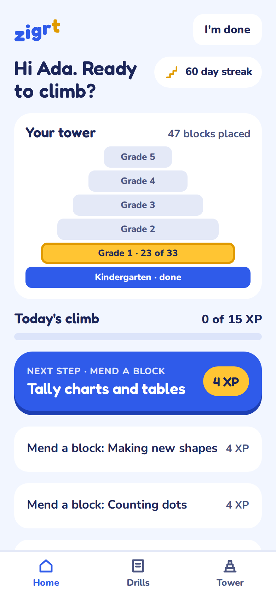
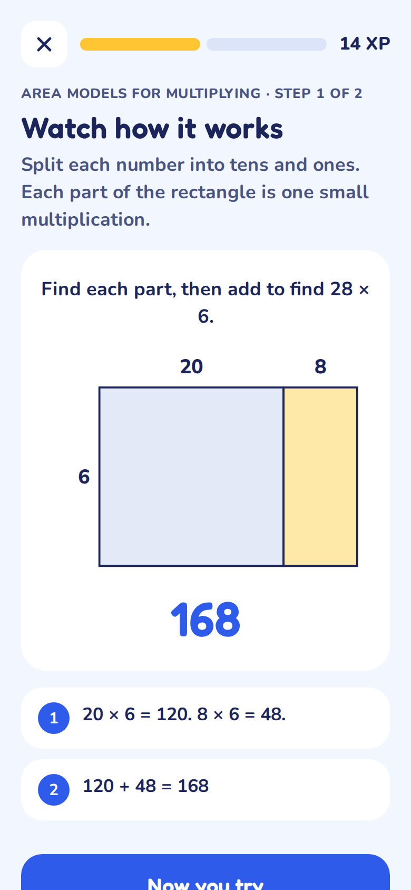
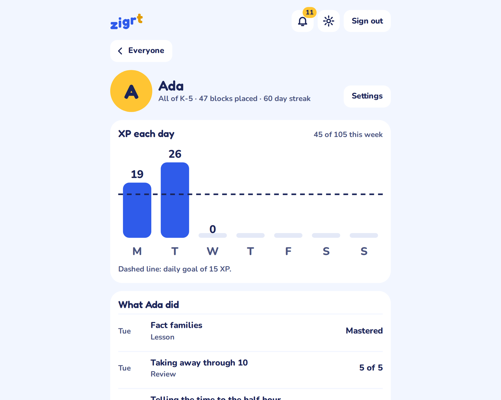

# zigrt

Self-hosted mastery-learning maths for one household. Zigrt decides what each child should work on next, teaches it in small steps, and brings it back for review just before it would be forgotten. The name is short for ziggurat: a tower climbed one tier at a time.

One container, one volume: a Go binary serving server-rendered HTML, with SQLite on the volume by default or Postgres if you point it at one. It ships with the complete K-5 curriculum: 255 lessons with pictures throughout.

**Website and docs: [chinny-labs.github.io/zigrt](https://chinny-labs.github.io/zigrt/)**

| A student's home | A lesson | A parent's view |
| --- | --- | --- |
|  |  |  |

Screenshots are from the demo household (`just screenshots` retakes them).

## Quickstart (Docker Compose)

```sh
mkdir zigrt && cd zigrt
curl -fsSLO https://raw.githubusercontent.com/chinny-labs/zigrt/main/deploy/compose/compose.yaml
openssl rand -base64 32 > zigrt_key.txt
docker compose up -d
docker compose logs zigrt | grep -i "setup token"
```

Open `https://<host>/setup`, paste the setup token, and create the first parent account. Then add your students.

> Sessions use `Secure` cookies, so put Zigrt behind a TLS reverse proxy (Caddy, Traefik, a Gateway). For a quick plain-HTTP trial on your LAN, set `ZIGRT_INSECURE_COOKIES: "true"` in `compose.yaml`.

On Kubernetes there is a Helm chart, `oci://ghcr.io/chinny-labs/charts/zigrt`. See [Install](docs/operations/install.md) for both, the database choice and every setting.

## What it does

- **Lessons and reviews:** a topic graph of 255 blocks from counting to fractions. Each lesson shows a worked example and asks until it sticks; spaced reviews bring blocks back just before they would be forgotten. See [How Zigrt teaches](docs/guide/how-it-works.md).
- **Placement:** an adaptive placement check, or start a child at their grade in one step.
- **Quizzes, XP, daily goals, streaks and rest days,** and a tower that grows a block at a time.
- **Drills and worksheets:** fact drills on a big number pad, and printable worksheets with answer keys. Parents can assign either.
- **Parents** see XP each day, what each child did, who is stuck, and a weekly email. See [Using Zigrt](docs/guide/parents.md).
- **API and MCP:** a JSON API and an opt-in MCP server, with scoped tokens ([API and MCP](docs/operations/api.md)).
- **Operations:** nightly SQLite snapshots, a portable export between SQLite and Postgres, Prometheus metrics, `/healthz` and `/readyz`.
- **Private by default:** no telemetry, no CDN assets, no outbound requests, no AI at run time. A strict Content-Security-Policy; pages work without JavaScript.

The lessons come from a separate content pack, [zigrt-curriculum](https://github.com/chinny-labs/zigrt-curriculum); each release embeds one ([Content packs](docs/operations/content.md)).

## Develop

Requires Go (see `go.mod`) and, for the end-to-end test, Docker and Node 22.

```sh
just run          # http://localhost:8080 with a SQLite file in ./data
just test         # unit tests and the store contract suite on SQLite
just test-pg      # the same suite on Postgres (just pg-up starts one)
just lint
just e2e          # build the image and drive it with Playwright
just screenshots  # retake docs/screenshots from the demo household
just site         # build the website into site/_site and check its links
```

The design lives in [`docs/design`](docs/design/README.md): the plan, the board sources and a render of every screen. Decisions are in [`docs/adr`](docs/adr/README.md).

## Licence

**AGPL-3.0-only**; see [LICENSE](LICENSE). Copyright (C) 2026 Jeffrey Chin. The `figure` package is also available under Apache-2.0 ([figure/LICENSE](figure/LICENSE)).

The bundled fonts, Fredoka and Nunito, are under the SIL Open Font License; their licence texts are in `internal/web/static/fonts`.
