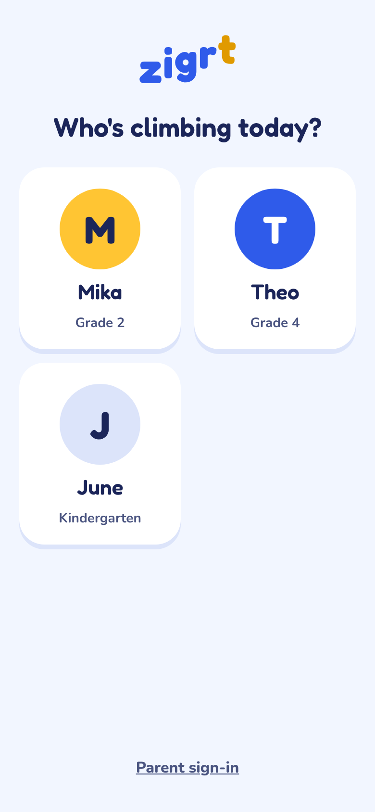
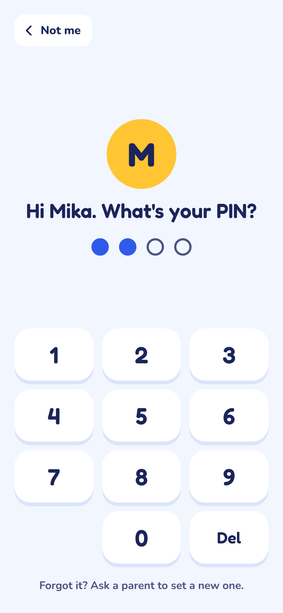
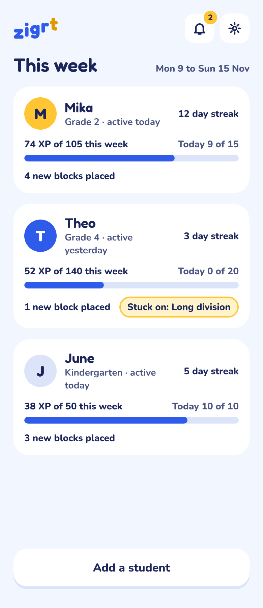

# zigrt

Self-hosted mastery-learning maths for one household. Zigrt decides what each child should work on next, teaches it in small steps, and brings it back for review just before it would be forgotten. The name is short for ziggurat: a tower climbed one tier at a time.

One container, one volume: a Go binary serving server-rendered HTML, with SQLite on the volume by default or Postgres if you point it at one.

> **Status: early.** This version has accounts, sign-in, drills and printable worksheets. Lessons, reviews and the placement check are not built yet, so the student home has no tasks. See the [plan](docs/design/plan.md) for what is coming and in what order.

| Who's climbing? | PIN pad | Parent dashboard |
| --- | --- | --- |
|  |  |  |

These are design renders, not screenshots of the running app.

## Quickstart (Docker Compose)

No image is published yet; until the first release, build it from a checkout with `just image`.

```sh
mkdir zigrt && cd zigrt
curl -fsSLO https://raw.githubusercontent.com/chinny-labs/zigrt/main/deploy/compose/compose.yaml
openssl rand -base64 32 > zigrt_key.txt
docker compose up -d
docker compose logs zigrt | grep -i "setup token"
```

Open `https://<host>/setup`, paste the setup token, and create the first parent account. Then add your students.

> Sessions use `Secure` cookies, so put Zigrt behind a TLS reverse proxy (Caddy, Traefik, a Gateway). For a quick plain-HTTP trial on your LAN, set `ZIGRT_INSECURE_COOKIES: "true"` in `compose.yaml`.

On Kubernetes there is a Helm chart in `deploy/helm/zigrt`. See [docs/operations/install.md](docs/operations/install.md) for both, the database choice and every setting.

## What it does today

- **First run:** a one-time setup token from the server log creates the first parent.
- **Parents** sign in with an email and password, add students, set a new PIN for a student and unlock one who is locked out.
- **Students** pick their name and type a 4 to 6 digit PIN on a large pad. Ten wrong PINs in a row lock the student until a parent unlocks them.
- **Drills:** a student picks any mix of +, −, × and ÷ at K-5 levels (or their own number ranges), across, stacked or missing-number layouts, and 10 to 50 problems, then answers on a big number pad or the keyboard with a chime for right and a soft sound for wrong. The server marks every answer again and saves the result. The results list the misses, with "Drill just these" to practise them again.
- **Worksheets:** the same choices, printed or saved as PDF from the browser, with name and date lines, large print and an answer key on its own page. Parents can make them too. Every sheet keeps its problems, so it reprints the same; "New version" gives fresh ones.
- Drills are free practice: they never change what a student has mastered.
- **Content tools:** the problem-template engine, the content-pack loader with every curriculum gate, and `zigrt-content`, the authoring tool the curriculum repo uses. Lessons will use them in the next phase. See [Writing content](docs/content/templates.md).
- **Database:** SQLite on the `/data` volume with nightly backups, or an existing Postgres by URL. The same test suite runs against both.
- **Private by default:** no telemetry, no CDN assets, no outbound requests. A strict Content-Security-Policy; pages work without JavaScript.

## Develop

Requires Go (see `go.mod`) and, for the end-to-end test, Docker and Node 22.

```sh
just run       # http://localhost:8080 with a SQLite file in ./data
just test      # unit tests and the store contract suite on SQLite
just test-pg   # the same suite on Postgres (just pg-up starts one)
just lint
just e2e       # build the image and drive it with Playwright
```

The design lives in [`docs/design`](docs/design/README.md): the plan, the board sources and a render of every screen. Decisions are in [`docs/adr`](docs/adr/README.md).

## Licence

**AGPL-3.0-only**; see [LICENSE](LICENSE). Copyright (C) 2026 Jeffrey Chin.

The bundled fonts, Fredoka and Nunito, are under the SIL Open Font License; their licence texts are in `internal/web/static/fonts`.
