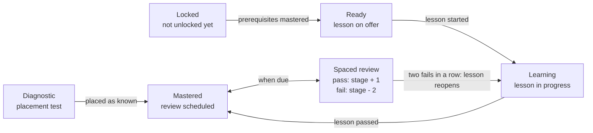
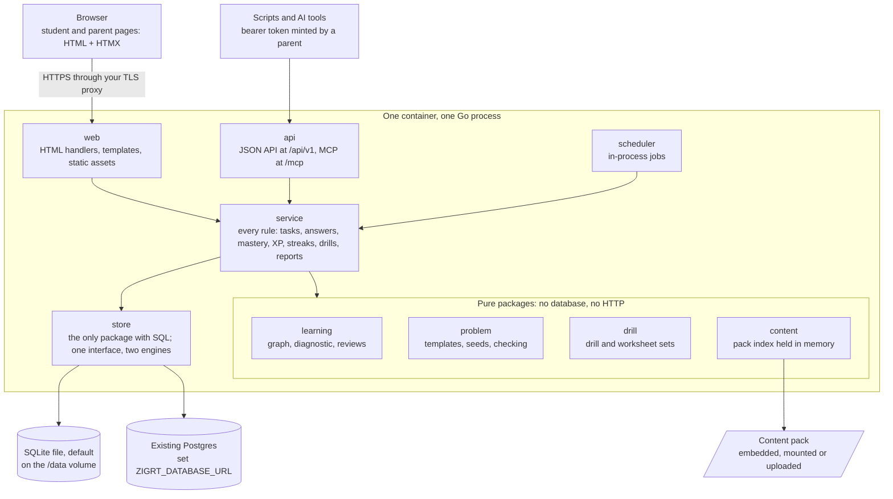

# Zigrt: Design & Architecture

Nov 15, 2026 · Jeffrey Chin

> Snapshot of the living plan doc: https://claude.ai/artifact/SRqR1CSEiCvG4e8QByRRS8 (exported 2026-11-15, rev 55). The doc is the source of truth; refresh this copy when it changes.

## 1. Overview

Zigrt (a shortening of ziggurat, a tower climbed one tier at a time) is a self-hosted mastery-learning maths app for one household: it decides what each child should work on next, teaches it in small steps, and brings it back for review just before it would be forgotten. It follows the method Math Academy uses (a prerequisite graph, a placement diagnostic, mastery gating, spaced review, XP) with its own code, curriculum, name and look.

It ships as one container image: a Go binary serving server-rendered HTML with HTMX, storing data in SQLite on a volume by default or in an existing Postgres. Operators deploy it with Docker Compose or a Helm chart. The structure, deployment and release process copy Goldberry; the curriculum lives in its own repository, as Copperkeep's does.

### Decisions already made

| Decision | Choice |
| --- | --- |
| Name | Zigrt, a shortening of ziggurat. Repo, image and chart `zigrt`; curriculum repo `zigrt-curriculum`; env prefix `ZIGRT_` |
| Stack | Go + server-rendered HTMX, one container, small JS islands |
| Database | SQLite by default; existing Postgres by URL. No bundled Postgres workload in Compose or the chart |
| Audience | One household per deployment: parents and their kids |
| First curriculum | K-5 arithmetic; the engine is grade-agnostic |
| Launch scope | Version 1.0 ships with all of K-5, every strand |
| Content | Separate curriculum repo, released as a versioned content pack |
| Standards | Topics may carry Common Core codes; shown to parents only |
| LLM | None. Problems are generated, explanations are authored |
| Drills and worksheets | Free practice: saved and worth a little XP, never change mastery |
| Assigning work | A parent can assign a drill or worksheet to a student. Lessons and reviews are chosen by the engine only |
| Fluency timing | On by default for fact topics; a parent can turn it off per student |
| Rewards | Tower milestones only. No badges or avatar items |
| Languages | English only in version 1, with all text keyed for translation from the start |
| Licences | App AGPL-3.0-only; curriculum CC BY-SA 4.0; the `problem` and `content` packages and the `zigrt-content` tool Apache-2.0 |
| Template expressions | A purpose-built evaluator with exact fractions, not `cel-go` (ADR 9) |

### Goals

- A child opens the app and always has a clear next task that takes 5 to 10 minutes.
- Nothing new is taught until its prerequisites are mastered; nothing mastered is left to decay.
- A parent can see, in one screen, what each child did this week and where they are stuck.
- A child can build a drill or a printable worksheet in under 30 seconds.
- An operator gets from nothing to a running instance in about a minute, and upgrades by changing an image tag.
- Works fully offline on a home network: no CDN, no telemetry, no outbound calls.

### Non-goals

- No Math Academy content, branding, screens or wording. This is the method, not a copy of the product.
- No classrooms, teacher role or multi-tenancy.
- No LLM tutor, chat or generated explanations.
- No content beyond K-5 in version 1, and no in-browser content editor.
- No native mobile app; the web UI is phone- and tablet-first.

### Design principles

1. **The server decides.** Every mastery, scheduling and XP rule lives in the `service` layer. The browser shows a question and posts an answer.
2. **Append-only history.** Every answer is an immutable event. Mastery state is a projection that can be rebuilt from the log.
3. **Content is data.** The app knows nothing about fractions. Topics, prerequisites, lessons and problem templates come from the content pack.
4. **Deterministic.** A problem is a template plus a seed. The same seed always gives the same problem, so any attempt can be replayed and any worksheet reprinted.
5. **Works without JS where it can.** Lessons, reviews and worksheets work as plain forms. Timed drills and sounds need JS.
6. **Boring to operate.** One process, one volume, migrations at startup, nightly backups.

## 2. Users and accounts

There are two roles, parent and student, in a single household. The operator is whoever runs the container; they have no in-app role beyond the first-run setup token.

| Role | Signs in with | Can do |
| --- | --- | --- |
| Parent | Email and password | Add and manage students, set each student's course and daily XP goal, see reports, reset PINs, unlock accounts, manage API tokens, install content packs, export data |
| Student | Pick your name, then a 4 to 6 digit PIN on a large pad | Take the diagnostic, do lessons, reviews and quizzes, build drills and worksheets, see their own progress |

- **First run:** the server prints a one-time setup token to its log. `/setup` takes that token and creates the first parent. This is Goldberry's flow unchanged.
- **Credentials:** passwords and PINs are hashed with argon2id. Throttling is per account. A student hard-locks after 10 wrong PINs and only a parent can unlock them.
- **Sessions:** server-side sessions in the database, a `Secure`, `HttpOnly`, `SameSite=Lax` cookie, and a CSRF token on every form. Student sessions last 30 days on a device; parent sessions 7 days.
- **Authorization:** a student can only read and write their own data. A parent can read every student in the household. Parents cannot answer questions on a student's behalf, so the event log stays honest.
- **Parents can also learn.** A parent may add a student profile for themselves; it is an ordinary student record.
- **Optional email:** SMTP settings enable password reset and a weekly progress email. With no SMTP configured, a parent resets a password with a CLI command inside the container.

## 3. Learning model

Each student has a state for every topic in their course, and the server picks the next task from those states: review what is due, then teach the next topic whose prerequisites are mastered. All numbers below are defaults held in one `service/learning` config struct so they can be tuned without touching logic.

### 3.1 Knowledge graph

A course is a directed acyclic graph of topics. The content pack declares two kinds of edge.

| Edge | Meaning | Used for |
| --- | --- | --- |
| `requires` | B cannot be learned before A is mastered | Unlocking lessons, diagnostic inference |
| `encompasses` (weight 0 to 1) | Doing B exercises A as a sub-skill | Implicit review credit, review compression |

Example: "2-digit + 2-digit with regrouping" requires "2-digit + 1-digit" and encompasses "sums to 20" at weight 1.0.

### 3.2 Topic states

| State | Meaning | Leaves when |
| --- | --- | --- |
| Locked | A prerequisite is not mastered | All `requires` topics are mastered |
| Ready | Can be offered as a lesson | The student starts the lesson |
| Learning | Lesson started, not passed | Every knowledge point is passed |
| Mastered | Lesson passed or placed by the diagnostic; on a review schedule | Two failed reviews in a row send it back to Learning |



A topic moves left to right once. After that it only cycles between Mastered and its reviews, unless two failed reviews in a row reopen the lesson.

### 3.3 Diagnostic

A new student takes an adaptive placement test of about 20 to 35 questions, split across sittings if they stop.

1. Every topic starts as unknown. The next question comes from the topic that would settle the most unknown topics whichever way it is answered.
2. A correct answer marks the topic and all of its prerequisites as probably known. A wrong answer, or "I haven't learned this", marks the topic and everything that requires it as not known.
3. A topic counts as known only after two correct answers on it or on topics that require it. This keeps a lucky guess from skipping material.
4. The test ends when no unknown topics remain or at 35 questions. Remaining unknowns are treated as not known.
5. Known topics become Mastered at review stage 2, so each is checked once within a week. The rest become Locked or Ready.

A parent can re-run the diagnostic or manually mark a topic mastered or not mastered. Both are recorded as events.

### 3.4 Lessons

A lesson teaches one topic in 2 to 4 knowledge points. Each knowledge point is a short explanation, one worked example shown step by step, then practice problems.

- A knowledge point is passed with 2 correct answers in a row.
- After a wrong answer the student sees the worked solution to that exact problem, then gets a fresh one.
- 3 wrong answers in a knowledge point stops the lesson for the day with a kind message. It resumes at that point next time.
- A lesson stopped twice schedules immediate reviews of its `requires` topics before it is offered again. Those reviews go to the front of the queue, ahead of older due reviews and never folded into another topic's review, so a backlog cannot hold the lesson back indefinitely (ADR 11).
- Passing every knowledge point makes the topic Mastered at stage 0, first review due the next day.

### 3.5 Spaced review

Each mastered topic has a stage and a due date. A review is 3 to 5 problems on that topic and is passed at 80% or better.

| Stage | 0 | 1 | 2 | 3 | 4 | 5 | 6 | 7+ |
| --- | --- | --- | --- | --- | --- | --- | --- | --- |
| Days until next review | 1 | 3 | 7 | 14 | 30 | 60 | 120 | 240 |

- **Pass:** stage + 1. **Fail:** stage - 2 (minimum 0), due tomorrow. Two fails in a row reopen the lesson.
- **Implicit credit:** passing a review or lesson on topic B gives each topic A that B encompasses a partial repetition. A's due date moves out by weight x A's current interval, and at weight 1.0 A's stage also advances if it was due. A child doing long multiplication is not also asked to review times tables.
- **Failure flows up:** failing A pulls forward by half the due date of mastered topics that encompass A.
- **Review compression:** when several topics are due, the server offers the one that encompasses the most other due topics.
- **Fluency topics:** a topic may set `fluency_seconds` (for example, 6 seconds for multiplication facts). Its reviews pass only if the median answer time is under the target. The child never sees a timer. This is on by default; a parent can switch it off per student.

### 3.6 Quizzes

After every 150 XP the next task is a quiz: 8 to 10 problems drawn from topics mastered since the last quiz, with no worked solutions until the end. Each missed topic gets an immediate review. Quizzes exist to catch topics the student passed but did not retain.

### 3.7 XP and streaks

One XP is roughly one minute of focused work for a student working at pace.

| Task | Base XP | Adjustment |
| --- | --- | --- |
| Lesson | Set per topic in the pack, usually 8 to 15 | +20% if no knowledge point needed more than one retry |
| Review | 3 to 5 | +1 if perfect; 0 if failed |
| Quiz | 15 | Scaled by score; 0 below 50% |
| Diagnostic | 1 per 2 questions | None |
| Free drill | 1 per 10 correct answers, at most 5 a day | None |

- Each student has a daily XP goal, default 15, set by a parent.
- A streak counts consecutive days the goal was met in the household time zone. Parents can set rest days (for example, weekends) that do not break a streak.
- Answers faster than a floor (1.5 seconds on a non-fluency problem) three times running pause the task with a "slow down" screen and earn no XP. This is the only anti-guessing rule in version 1.

### 3.8 Choosing the next task

The student home shows up to four tasks; the first is the recommended one. The list is computed on request from current state, not stored.

1. A lesson in progress, if any.
2. A quiz, if 150 XP have passed since the last one.
3. Due reviews, most overdue first, after compression; the prerequisites of a lesson stopped twice go first. At most 3 in a row before a lesson is offered, or 5 while more than 10 reviews are due (ADR 11).
4. New lessons from Ready topics, in the pack's teaching order, alternating strands where the graph allows (for example, addition then measurement then addition).

If nothing is due and nothing is Ready, the course is complete and the home screen says so and offers early reviews and drills.

### 3.9 Answer types

Answers are checked on the server with exact rational arithmetic, never floating point.

| Type | Example | Input |
| --- | --- | --- |
| Integer | 347 | Number pad |
| Decimal | 3.75 | Number pad with a point key |
| Fraction or mixed number | 2 3/4 | Whole, numerator and denominator boxes; the template says whether simplest form is required |
| Quotient and remainder | 12 r 3 | Two boxes |
| Comparison | 3/4 > 2/3 | Three buttons: <, =, > |
| Multiple choice | Which shape is a pentagon? | Up to 4 large buttons |

## 4. Curriculum and content

The curriculum is a second repository, `zigrt-curriculum`, that builds a single versioned content pack file; each app release embeds one pinned pack so a fresh install works with no downloads. This mirrors `copperkeep-curriculum`, adapted to a one-container app.

### 4.1 What a pack contains

| File | Contents |
| --- | --- |
| `manifest.yaml` | Pack version (calendar, such as `2027.02.1`), `min_app_version`, licence, locales, courses |
| `topics.yaml` | Every topic: stable ID, title, strand, grade band, `requires`, `encompasses`, base XP, optional standards codes (Common Core, shown to parents only), optional `fluency_seconds`, teaching order |
| `topics/<id>.yaml` | The lesson: knowledge points, each with explanation text, a worked example and one or more problem templates |
| `drills.yaml` | The drill catalogue: operations, levels and styles offered by the worksheet builder (section 5) |
| `figures/` | SVG figure templates (number lines, fraction bars, clocks, coins, shapes) |
| `released-ids.json` | Every topic and template ID ever released |

### 4.2 Problem templates

A problem is a template plus a seed. Templates are declarative so that content authors never write Go and the app never runs pack-supplied code.

```yaml
id: add-2d-2d-regroup.kp2.t1
vars:
  a: {int: [10, 99]}
  b: {int: [10, 99]}
where:
  - (a % 10) + (b % 10) >= 10      # forces regrouping in the ones
  - a + b <= 99
prompt: "{a} + {b}"
layout: stacked                     # text | across | stacked | missing | long-division | figure
op: "+"
parts: [a, b]
answer: {type: integer, value: a + b}
solution:
  - "Add the ones: {a % 10} + {b % 10} = {(a % 10) + (b % 10)}. Write {(a + b) % 10}, carry 1."
  - "Add the tens: {a // 10} + {b // 10} + 1 = {(a + b) // 10}."   # // is whole-number division
  - "{a} + {b} = {a + b}"
```

- **Expressions** are evaluated by a small purpose-built evaluator in which every number is an exact fraction, so `/` is exact and `//` is whole-number division (ADR 9, chosen over `cel-go` after writing the 20 hardest topics against both). There are no loops, no I/O and a fixed step budget. The full format is in `docs/content/templates.md`.
- **Generation** draws variables from a PRNG seeded with (template ID, seed) and retries until `where` holds, up to a fixed limit. Each `where` is checked as soon as its variables exist. The pack's CI proves every template succeeds.
- **Worked solutions** can leave out a step that does not apply, with `{when: ..., text: ...}`.
- **Layouts** are the ones the math drill app already has (across, stacked, missing number, long division), `text` for word problems, and `figure`, which draws a figure from the app's catalogue (fraction bar, number line, clock, rectangle, box, coordinate grid, array) from the variables, or shows a static SVG from the pack.
- **Distractors** for multiple choice are expressions too, so wrong options reflect real mistakes (for example, forgetting to carry).

### 4.3 Rendering maths

K-5 notation needs no TeX. Stacked arithmetic, long division, fractions and mixed numbers are HTML and CSS, ported from `chinny-labs/math`'s `render.js` and print styles. Figures are SVG drawn on the server, as Goldberry does for charts (its ADR 0013). If a later course needs algebra, MathML rendered by the server is the planned route.

### 4.4 Courses and scope

Version 1 ships one graph, "Arithmetic K-5", of roughly 300 topics (an estimate to be confirmed when the syllabus is written). A course is a named target set within the graph, so a parent can assign "Grade 2" or "All of K-5"; the diagnostic covers the course and its prerequisites.

| Strand | Runs from | To |
| --- | --- | --- |
| Counting and place value | Counting to 20 | Place value to millions, rounding |
| Addition and subtraction | Sums to 10 | 4-digit with regrouping, word problems |
| Multiplication | Equal groups, tables to 5 | 2-digit x 2-digit, factors and multiples |
| Division | Sharing, facts to 5 | Long division by 2-digit divisors, remainders |
| Fractions | Halves and quarters | Add and subtract unlike denominators, multiply fractions |
| Decimals | Tenths and hundredths | Four operations with decimals, fraction-decimal conversion |
| Measurement and data | Time, money, length | Unit conversion, perimeter, area, volume, reading graphs |
| Geometry | Naming shapes | Angles, classifying polygons, coordinate grid |

### 4.5 The ID contract

Topic and template IDs are stored as opaque strings in the append-only event log. They are never renamed or reused. Splitting or merging a topic is a `transitions` entry in `topics.yaml`, applied when mastery is projected. CI fails if an ID in `released-ids.json` disappears.

### 4.6 Curriculum CI gates

| Gate | Catches |
| --- | --- |
| `structure` | A cycle in the graph, an edge to a missing topic, a topic with no knowledge points |
| `ids` | A released ID that vanished without a transition |
| `generate` | A template that fails, or yields fewer than 30 distinct problems, across 1,000 seeds |
| `answers` | An answer of the wrong type, a negative result where the topic forbids it, a division that should be exact and is not |
| `solutions` | A worked solution whose last line does not state the computed answer |
| `readability` | Explanation text above the topic's grade band, or a sentence that is too long |
| `subresources` | Any external URL. Everything ships in the pack |

### 4.7 How a pack reaches the app

1. The curriculum repo's release job publishes `zigrt-content-<version>.tar.gz` and its SHA-256 as a GitHub release asset.
2. The app repo pins a version and checksum in one file. The image build downloads and embeds that pack.
3. At startup the app loads the embedded pack, or a newer one found in `ZIGRT_CONTENT_DIR` (a mounted folder), validates it and refuses to become ready if `minAppVersion` is not met.
4. A parent can also upload a pack file on the Settings page. It is stored in the data volume and survives upgrades.

Licensing: the app is AGPL-3.0-only and the curriculum is CC BY-SA 4.0. The problem and content packages that the authoring CLI imports are Apache-2.0, so that third-party curriculum tools can use them.

### 4.8 Authoring CLI

The curriculum repo uses a command-line tool, `zigrt-content`, that gives an author (a person or Claude Code) an answer in seconds about whether a topic works. It is required, not optional: around 300 topics cannot be written well without a fast feedback loop.

| Command | Does |
| --- | --- |
| `zigrt-content lint [topic]` | Validates structure, IDs, edges and template syntax for one topic or the whole pack |
| `zigrt-content sample <template> --seeds 1-20` | Prints the generated problems, answers and worked solutions for a range of seeds |
| `zigrt-content preview <topic>` | Renders the lesson to a local HTML page using the app's own layouts and CSS |
| `zigrt-content graph [--strand s]` | Prints the prerequisite graph, and flags unreachable topics and long chains |
| `zigrt-content check` | Runs every CI gate from section 4.6 locally |
| `zigrt-content build --out dist` | Builds the pack file exactly as the release job does |

The tool is written in Go and imports the app's `problem` and `content` packages, so a template behaves identically in authoring, in CI and in the running app. It is built in the app repo (`cmd/zigrt-content`) and the curriculum repo pins it with a `tool` line in its `go.mod`, so the tool always matches the app release it targets (ADR 10). `preview` arrives with the lesson layouts in phase 3.

## 5. Drills and worksheets

Any student (or parent) can build a drill to answer on screen or a worksheet to print, choosing the operations, difficulty and layout themselves. This is the `chinny-labs/math` app moved inside Zigrt, with history and reprinting added. It is free practice: it never changes mastery or the review schedule.

### 5.1 The builder

One screen with the same choices the math drill app offers today.

| Choice | Options |
| --- | --- |
| Operations | Any mix of +, -, x, / |
| Level per operation | The existing K-5 levels (for example "Sums to 10", "Times tables to 12", "3-digit / 2-digit") or a custom number range |
| Problem styles | Across (`7 + 5 = ?`), stacked, missing number (`7 + ? = 12`); several can be mixed |
| Rules | Subtraction never goes negative; division is exact unless "Allow remainders" is on |
| Count | 10, 20, 30 or 50 problems |
| Output | Drill on screen, or worksheet to print |

Two additions over the current app:

- **From my topics.** A student can instead pick topics they have mastered, and the drill is built from those topics' pack templates. This covers fractions, decimals and anything else the pack teaches.
- **Presets.** The last settings are remembered per student, and a student can save named presets ("Friday times tables"). A parent can save presets that appear for every student. A parent can also assign a preset to one student; it then shows on that student's home screen as a task from the parent until it is done. Lessons and reviews are never assigned: the engine alone chooses those.

### 5.2 On-screen drills

- The server generates the whole problem set from the settings and a seed, stores it, and sends it to the page. A small JS module runs the drill: big number pad, keyboard support, a chime for right and a soft sound for wrong, both synthesised in the browser as they are now.
- A wrong answer shows the right one before moving on. The results screen lists misses and offers "Drill just these".
- Answers and per-question times are posted when the drill ends (and on page unload). The server re-checks every answer; the browser's own marking is only for instant feedback.
- Each finished drill is saved to the student's history with score and time. A parent sees drills in the activity feed.
- XP is 1 per 10 correct answers, capped at 5 a day, so drills are rewarded but cannot replace lessons.

### 5.3 Printable worksheets

- A worksheet is a server-rendered page with print styles for Letter and A4, printed or saved as PDF from the browser. The server does not generate PDFs, which keeps the image small and free of a headless browser.
- Options: title, name and date lines, problems per row, large-print mode, and an answer key on a separate page.
- Every worksheet has a permanent URL built from its saved settings and seed, so the same sheet and key can be reprinted later, and "New version" gives the same settings with a fresh seed.
- Worksheets work with JS disabled.

### 5.4 Implementation notes

- `js/generator.js` is ported to Go as `internal/drill`, with its level table moved into the pack's `drills.yaml` so the curriculum repo can add levels.
- Problem layouts are shared by lessons, drills and worksheets: one set of HTML templates and CSS classes.
- The existing GitHub Pages app stays as it is; nothing in Zigrt depends on it.

## 6. Screens and flows

This section is the brief for Claude Design: 22 screens, each needing a phone layout and a desktop or tablet layout, in light and dark. The design board and its tokens become the source of truth under `docs/design/`, as in Goldberry.

### 6.1 Constraints the design must respect

- **Server-rendered.** Every screen is an HTML page or an HTMX partial. No client-side routing, and no layout that depends on JS to be usable (except the on-screen drill).
- **Strict CSP.** No inline `style=` attributes, no inline scripts, no CDN assets. Fonts are self-hosted in the image.
- **Tokens.** Colours, type scale, spacing and radii are CSS custom properties in one `app.css`. Dark mode swaps tokens only.
- **Touch first.** Students are 5 to 11 years old on tablets and phones. Answer targets are at least 56 px; the number pad fills the lower half of a phone screen.
- **Reading level.** Student-facing text is short and at or below the grade band. Every instruction also works as an icon plus one or two words.
- **Calm.** Feedback is immediate and kind. No countdown timers, no leaderboards, no red failure screens.
- **Accessible.** WCAG AA contrast, visible focus, full keyboard operation, `prefers-reduced-motion` respected, and nothing conveyed by colour alone.
- **Print.** Worksheets have their own print stylesheet: black on white, no chrome.

### 6.2 Student screens

| # | Screen | What it shows and does |
| --- | --- | --- |
| S1 | Who's learning? | A tile per student (avatar and name), plus a quiet "Parent sign-in" link |
| S2 | PIN pad | Large digits, dots for entered digits, a locked state that says to ask a parent |
| S3 | Home | Today's XP ring against the goal, streak, the recommended task as one big button, up to three other tasks, any drill or worksheet a parent has assigned, and entries for Drills and Progress |
| S4 | Diagnostic intro | What the placement check is, that not knowing is fine, about how long it takes |
| S5 | Diagnostic question | One problem, the answer input, and an "I haven't learned this" button; a progress bar without a score |
| S6 | Lesson: explanation | Topic title, a short explanation with a figure, and the worked example revealed step by step |
| S7 | Lesson: practice | One problem, the answer input for its type, "Check"; progress dots for the knowledge points |
| S8 | Feedback | Right: a brief positive state and "Next". Wrong: the correct answer and the worked solution for that problem, then "Try another" |
| S9 | Task complete | XP earned, the ring filling, streak change, and the next recommended task |
| S10 | Lesson paused | The kind "we'll come back to this" screen after three misses |
| S11 | Review and quiz | Same problem layout as S7 with a different header; quiz results at the end list each problem with its solution |
| S12 | Progress | The topic map by strand: locked, ready, learning and mastered states; tap a topic for its history and next review date |
| S13 | Drill builder | Operations, levels, styles, count, and the choice of drill or worksheet; presets; the "From my topics" picker |
| S14 | Drill | Problem, big number pad, progress count, sound toggle, stop |
| S15 | Drill results | Score, time, list of misses, "Drill just these", "Again" |
| S16 | Worksheet preview | The sheet as it will print, options (name and date lines, answer key, large print), "Print" and "New version" |

### 6.3 Parent screens

| # | Screen | What it shows and does |
| --- | --- | --- |
| P1 | Sign-in and first-run setup | Email and password; the setup-token form on first run |
| P2 | Dashboard | A card per student: XP today and this week against the goal, streak, topics mastered this week, last active, and a "stuck on" flag |
| P3 | Student detail | XP per day chart, the activity feed (every lesson, review, quiz and drill with score), the topic map, topics with repeated failures, and worksheets made |
| P4 | Student settings | Name, avatar, PIN reset, unlock, course, daily XP goal, rest days, fluency timing on or off, re-run diagnostic, mark a topic mastered or not, assign a drill or worksheet |
| P5 | Household settings | Parents, time zone, email, content pack version and upload, backups and export, API tokens |
| P6 | Notifications | The bell: goal met, streak lost, a lesson stopped twice, a student locked out, a new pack available in the content folder |

### 6.4 Key flows

1. **First run:** setup token, create parent, add a student (name, avatar, PIN, course), hand the device over, diagnostic.
2. **Daily session:** S1, S2, S3, a task (S6 to S8, or S11), S9, and repeat until the ring is full.
3. **Worksheet:** S3, S13, S16, print.
4. **Parent check-in:** P2, P3, optionally adjust in P4.

### 6.5 Components to design once

The answer inputs for the six answer types (section 3.9), the problem layouts (across, stacked, missing number, long division, fraction, figure), the number pad, the XP ring, the streak badge, the topic node in its four states, the task card, and the worked-solution stepper.

### 6.6 Brand and identity

The brand should feel like climbing: steady upward progress, one tier at a time, where each level stands on the one below. That is also how the prerequisite graph works, so the brand and the product tell the same story.

- **Name:** Zigrt, a shortening of ziggurat.
- **Logo directions for Claude Design to explore:**
  1. A stepped tower of three or four tiers with a stair or path running up one face.
  2. A wordmark whose five letters step upward along a rising baseline.
  3. A letter Z drawn as a switchback staircase.
- **Logo requirements:** readable as a 16 px favicon, works in one colour, works on light and dark, and has a square app-icon form.
- **Climbing in the product:**
  - The progress map (S12) is a tower. Grade bands are tiers, strands are faces, and each mastered topic is a placed block.
  - The student's avatar stands at their current height. Finishing a lesson is a step up (S9).
  - Reviews are upkeep: a topic due for review is a block that needs mending, not height lost.
  - Today's XP goal can be shown as today's stretch of the climb rather than a bare ring, if the board finds a form that stays simple.
- **Tone:** patient and encouraging. Height comes from effort, not speed. Nobody falls: a failed review never visibly drops the child down the tower.
- **Avoid:** racing other climbers, summit-or-fail framing, religious imagery, and anything that looks like a casino reward.

**Rewards are tower milestones.** There are no badges or avatar items. Finishing a tier (a grade band) or a whole strand face changes the tower visibly, for example a banner on that tier or a new finish on its blocks. The board should define the milestone states for a tier and a face, and the moment a student sees one being earned (on S9).

## 7. Architecture

Zigrt is one Go process with Goldberry's layering: `web` and `api` call `service`, `service` calls `store`, and only `store` contains SQL. Two pure packages, `learning` and `problem`, hold the algorithms and have no database or HTTP dependencies, so they can be tested exhaustively.



Arrows show who calls or reads whom. Requests enter through `web` or `api`, every rule runs in `service`, and the database and the content pack are each reached through exactly one package.

### 7.1 Stack

| Concern | Choice |
| --- | --- |
| Language and runtime | Go, static binary (`CGO_ENABLED=0`), distroless nonroot base image |
| HTTP | Standard library `net/http` router, `html/template`, HTMX vendored into the image |
| Client JS | Three small ES modules with no build step: answer pad, drill runner, sounds |
| SQLite driver | Pure-Go SQLite (the one Goldberry uses), WAL mode |
| Postgres driver | `pgx` |
| Migrations | Numbered SQL files per engine, embedded, applied at startup |
| Charts and figures | SVG drawn by the server |
| Tooling | `just` for tasks, `golangci-lint`, Playwright for end-to-end tests |

### 7.2 Packages

```text
cmd/zigrt/            serve and the operator commands (section 11.1)
internal/
  config/              environment variables and *_FILE secrets
  auth/                passwords, PINs, sessions, CSRF, throttling, setup token
  web/                 HTML handlers, templates, static assets (app.css, JS modules, fonts)
  api/                 JSON API, openapi.json, optional MCP server
  service/             every rule: tasks, answers, mastery, XP, streaks, drills, reports
  learning/            pure: graph, diagnostic, review schedule, task selection
  problem/             pure: template parsing, expression evaluation, generation, answer checking
  drill/               pure: drill and worksheet problem sets (port of generator.js)
  content/             pack loading, validation, version checks, in-memory index
  store/               Store interface; sqlite/ and postgres/ implementations; storetest/
  scheduler/           in-process jobs
  backup/  notify/  buildinfo/
migrations/sqlite/  migrations/postgres/
deploy/compose/  deploy/helm/zigrt/
docs/adr/  docs/design/  docs/operations/
e2e/  site/  scripts/
```

### 7.3 Rules of the layering

- Handlers parse input, call one `service` method and render. They never call the store.
- `service` opens the transaction, loads state through `store`, calls `learning` and `problem` with plain values, and writes the results.
- `learning` and `problem` take a clock and a PRNG as arguments. They never read the time or random numbers themselves.
- The content pack is loaded once into an immutable in-memory index and swapped atomically when a new pack is installed. Content is not copied into the database.

**Text and languages.** Version 1 ships English only, but no user-facing string is written directly in a template. UI text comes from a message catalogue keyed by ID, and pack text (titles, explanations, prompts, solution steps) sits under a locale key in each topic file. Adding a language later means adding catalogue and pack files, not changing code.

### 7.4 Submitting an answer

1. The page posts the answer with the `attempt_id` it was given when the problem was shown.
2. `service.SubmitAnswer` starts a transaction and loads the task. If that `attempt_id` is already answered, it returns the stored result (double taps and retries are harmless).
3. It regenerates the problem from template ID and seed, and checks the answer with `problem.Check`.
4. It appends an `attempts` row, then asks `learning` for the new task and topic state and writes them, along with any XP.
5. It commits and returns the next step: feedback, the next problem, or the task-complete screen, as an HTMX partial or a full page.

### 7.5 Background jobs

Jobs run inside the process on a small scheduler (Goldberry's ADR 0005). Each job records its last run so that it catches up after downtime and never runs twice for the same day.

| Job | When | Does |
| --- | --- | --- |
| Day rollover | Household midnight | Closes the day's XP total, updates streaks, raises notifications |
| Backup | Nightly, configurable | With SQLite, writes a dated backup to the volume and prunes old ones. With Postgres, the operator backs up the database |
| Weekly email | Sunday evening, if SMTP is set | Sends each parent the week's summary |
| Housekeeping | Hourly | Expires sessions, abandons tasks idle for 7 days |

### 7.6 Deliberately excluded

- No message queue, cache or second service.
- No horizontal scaling: one replica, including with Postgres. A household does not need more, and it removes job leader election.
- No WebSockets or server-sent events. HTMX requests are enough.
- No server-side PDF generation and no headless browser in the image.

## 8. Data model

The database holds people, the append-only record of what they did, and projections of that record; curriculum content stays in the pack and is referenced by ID. Every table exists in both engines with the same columns, and all timestamps are UTC.

### 8.1 Tables

| Table | Key columns | Notes |
| --- | --- | --- |
| `household` | time zone, name, settings | Exactly one row |
| `users` | id, role (`parent` or `student`), name, email, credential hash, avatar, locked\_at | Parents have an email and password; students have a PIN |
| `sessions` | token hash, user\_id, expires\_at | Server-side sessions |
| `student_settings` | user\_id, course\_id, daily\_xp\_goal, rest\_days, fluency\_enabled | One row per student |
| `tasks` | id, student\_id, kind (`diagnostic`, `lesson`, `review`, `quiz`), topic\_id, status, state (JSON), started\_at, finished\_at, xp\_awarded | `state` holds the position within a task: knowledge point, streak, problems issued |
| `attempts` | id, task\_id, student\_id, topic\_id, template\_id, seed, answer\_given, correct, response\_ms, created\_at | **Append-only.** One row per answered problem. The source of truth for mastery |
| `mastery_events` | id, student\_id, topic\_id, kind (`placed`, `lesson_passed`, `review_passed`, `review_failed`, `implicit_credit`, `parent_override`, `reopened`), detail, created\_at | **Append-only.** Every change to a topic's state and why |
| `topic_state` | student\_id, topic\_id, state, stage, due\_at, last\_result, fail\_streak | **Projection.** Rebuildable from `mastery_events` |
| `xp_events` | id, student\_id, source (task or drill id), amount, local\_date | **Append-only** |
| `daily_totals` | student\_id, local\_date, xp, goal, goal\_met | **Projection** for streaks and charts |
| `drills` | id, owner\_id, kind (`drill` or `worksheet`), settings (JSON), seed, created\_at | The saved settings and seed regenerate the exact problem set |
| `drill_results` | drill\_id, student\_id, correct, total, duration\_ms, misses (JSON), finished\_at | One row per finished on-screen drill |
| `drill_presets` | id, owner\_id, shared, name, settings (JSON) | `shared` presets come from a parent. An assigned preset also records the student it is for and when it was done |
| `notifications` | id, user\_id, kind, payload, read\_at | The parent bell |
| `api_tokens` | id, parent\_id, token hash, scopes, last\_used\_at | For the JSON API and MCP |
| `audit_log` | id, actor\_id, via\_token, action, target, created\_at | Parent and token actions: overrides, PIN resets, pack installs |
| `job_runs` | job, last\_run\_for | Scheduler bookkeeping |
| `content_packs` | version, sha256, installed\_at, active | Uploaded pack files live on the volume; this table records which is active |

### 8.2 Rules

- `attempts`, `mastery_events` and `xp_events` are never updated or deleted. A correction is a new event (for example a `parent_override`).
- `topic_state` and `daily_totals` are written in the same transaction as the events they summarise. A `zigrt rebuild` command recomputes them from the logs and is run by a test after every scenario to prove the two agree.
- A topic ID that no longer exists in the active pack is kept in the logs and mapped through the pack's `transitions` at projection time.
- Deleting a student is a hard delete of all their rows, after a typed confirmation. It is the one exception to append-only, for privacy.

### 8.3 Dual-engine store

- `store.Store` is one Go interface with a SQLite and a Postgres implementation. SQL is hand-written per engine; there is no ORM.
- Every migration is the same numbered file in `migrations/sqlite` and `migrations/postgres`. `scripts/check-migrations.sh` fails CI if they drift.
- Every store behaviour has a case in `internal/store/storetest`, which runs against both engines.
- Types are kept portable: integer keys, text for IDs and enums, JSON stored as text in SQLite and `jsonb` in Postgres, timestamps as UTC.
- Migrations run at startup inside a transaction and the process exits if one fails.

## 9. Deployment

Zigrt is one multi-arch image, `ghcr.io/chinny-labs/zigrt`, deployed with a Compose file or a Helm chart; both set the same environment variables. The database choice is a single setting: leave it alone for SQLite on the data volume, or set a URL to use an existing Postgres.

### 9.1 Database choice

| Mode | How to select it | What gets deployed | Operator's responsibility |
| --- | --- | --- | --- |
| Default: SQLite | Nothing to set (`sqlite:///data/zigrt.db`) | The app container and one volume. No database workload | Keep the volume on block storage, never NFS or SMB |
| Existing Postgres | `ZIGRT_DATABASE_URL=postgres://...` or a Secret holding it | The app container only; the volume holds uploaded packs | Create the database and user; back it up |

- The app creates its schema at startup in either mode.
- `zigrt export` and `zigrt import` write and read an engine-independent JSON Lines dump, so a household can move between SQLite and Postgres in either direction.
- Neither Compose nor the chart bundles a Postgres server. SQLite is the default database, as decided in section 1.

### 9.2 The image

- Built with `docker buildx` for `linux/amd64` and `linux/arm64`. A static binary on `gcr.io/distroless/static-debian12:nonroot`.
- Runs as UID 65532 with a read-only root filesystem. `/data` is the only writable path and is declared as a volume.
- Listens on 8080. `HEALTHCHECK` calls `zigrt healthcheck`. `/healthz` reports liveness and `/readyz` reports readiness (database reachable, migrations applied, a valid content pack loaded).
- The pinned content pack, HTMX, fonts, CSS and JS are embedded in the binary.
- Tags: `1.4.2`, `1.4`, `1` and a digest. No `latest`.

### 9.3 Docker Compose

`deploy/compose/compose.yaml` is a single service, usable as a 60-second quickstart.

```yaml
services:
  zigrt:
    image: ghcr.io/chinny-labs/zigrt:1
    restart: unless-stopped
    ports: ["8080:8080"]
    environment:
      ZIGRT_SECRET_KEY_FILE: /run/secrets/zigrt_key
      ZIGRT_BASE_URL: https://zigrt.home.example.com
      TZ: America/New_York
      # Use an existing Postgres instead of SQLite:
      # ZIGRT_DATABASE_URL_FILE: /run/secrets/zigrt_db_url
    volumes:
      - zigrt-data:/data
    secrets: [zigrt_key]
volumes:
  zigrt-data:
secrets:
  zigrt_key:
    file: ./zigrt_key.txt   # openssl rand -base64 32 > zigrt_key.txt
```

### 9.4 Helm chart

`deploy/helm/zigrt`, published as an OCI chart at `oci://ghcr.io/chinny-labs/charts/zigrt`. Its values are the same shape as Goldberry's.

| Values key | Purpose |
| --- | --- |
| `image.*`, `replicaCount: 1` | Image and the fixed single replica (the chart fails to render with more) |
| `timezone`, `baseURL`, `trustedProxies`, `insecureCookies`, `logFormat` | Application settings |
| `secretKey.value` or `secretKey.existingSecret` | Session key; generated and kept across upgrades if both are empty |
| `postgres.external.url` or `postgres.external.existingSecret` | Use an existing Postgres. Empty means SQLite |
| `persistence.*` | The `/data` PVC: size, storage class, existing claim. ReadWriteOnce, block-backed |
| `content.existingClaim` | Optional volume of extra content packs mounted at `ZIGRT_CONTENT_DIR` |
| `backup.schedule`, `backup.retain` | Nightly SQLite backups |
| `smtp.*` | Optional email |
| `mcp.enabled` | Serve the MCP endpoint |
| `ingress.*`, `httpRoute.*` | Ingress or Gateway API route |
| `resources`, security contexts, `extraEnv`, scheduling | Standard pod settings; non-root, read-only root, all capabilities dropped |

The workload is a Deployment with strategy `Recreate`, so two pods never open the SQLite file at once.

### 9.5 TLS

Session cookies are `Secure`, so Zigrt expects a TLS reverse proxy or gateway in front (Caddy, Traefik, an Ingress). `ZIGRT_INSECURE_COOKIES=true` allows a plain-HTTP trial on a LAN.

## 10. Configuration, security and operations

All configuration is environment variables with the `ZIGRT_` prefix; any secret can instead be read from a file by adding `_FILE` to its name. Only the secret key is required.

### 10.1 Settings

| Variable | Default | Purpose |
| --- | --- | --- |
| `ZIGRT_SECRET_KEY` | none (required) | 32+ random bytes, base64. Signs sessions and CSRF tokens |
| `ZIGRT_DATABASE_URL` | `sqlite:///data/zigrt.db` | `sqlite://` path or `postgres://` URL |
| `ZIGRT_BASE_URL` | none | Public URL, used in email links |
| `ZIGRT_LISTEN` | `:8080` | Listen address |
| `TZ` | `UTC` | Default household time zone at setup |
| `ZIGRT_CONTENT_DIR` | `/data/content` | Folder scanned for content packs newer than the embedded one |
| `ZIGRT_BACKUP_SCHEDULE`, `ZIGRT_BACKUP_RETAIN` | `03:15`, `14` | Nightly SQLite backups |
| `ZIGRT_TRUSTED_PROXIES` | none | CIDRs whose `X-Forwarded-For` is trusted |
| `ZIGRT_INSECURE_COOKIES` | `false` | Drop the cookie `Secure` flag for plain-HTTP testing |
| `ZIGRT_SMTP_*` | none | Host, port, security, username, password, from address |
| `ZIGRT_MCP_ENABLED` | `false` | Serve the MCP endpoint at `/mcp` |
| `ZIGRT_LOG_FORMAT` | `json` | `json` or `text` |

### 10.2 Security

- **Headers:** a strict Content-Security-Policy (`default-src 'self'`, no inline script or style), `X-Content-Type-Options`, `Referrer-Policy`, frame denial.
- **Credentials:** argon2id hashes; per-account throttling; student hard-lock after 10 wrong PINs; a one-time setup token for first run.
- **Requests:** CSRF tokens on every state-changing form; session cookies are `Secure`, `HttpOnly`, `SameSite=Lax`.
- **Content packs are untrusted input.** They contain data only. Templates are evaluated in a sandbox with a step budget, text is HTML-escaped, and SVG figures are checked against an allowlist of elements and attributes when the pack loads.
- **Answers are checked on the server** from the stored template ID and seed. The page never receives the answer to a lesson, review or quiz problem before it is submitted.
- **Privacy:** no telemetry and no outbound requests apart from SMTP if configured. Student records hold a first name, an avatar choice and a PIN hash; no email or date of birth.

### 10.3 Backup, restore and upgrade

- **SQLite:** a nightly online backup to `/data/backups`, 14 kept by default. Restore is stopping the container and copying a backup into place.
- **Postgres:** the operator's own backups. `zigrt export` gives an engine-independent dump as an extra.
- **Upgrade:** change the image tag. Migrations run at startup. A SQLite backup is taken automatically before any migration is applied.
- **Content upgrade:** a new pack arrives with a new image, a file dropped in the content folder, or an upload. Student history is unaffected because of the ID contract.

### 10.4 Observability

Structured logs to stdout with a request ID; `/healthz` and `/readyz`; an optional Prometheus `/metrics` endpoint (requests, latency, job runs, active students), off by default. Operations guides live in `docs/operations/`: install, upgrade, backup and restore, content packs, API, troubleshooting.

## 11. API and integrations

A JSON API at `/api/v1` and an optional MCP server expose read access and a few parent actions, using the same `service` methods as the web UI. Both follow Goldberry's `internal/api` pattern.

- **Auth:** bearer tokens minted by a parent, each with scopes (`read`, `manage`). Actions through a token are written to `audit_log` with `via_token`.
- **Registration:** routes register through one helper that takes method, path and scope. `openapi.json` is checked against the registered routes by a test.
- **Not exposed:** answering problems. Learning happens in the web UI only, so the event log reflects real work.

| Area | Operations |
| --- | --- |
| Students | List students; get one student's summary (XP today and this week, streak, goal, last active) |
| Progress | Topic states for a student; activity feed; topics with repeated failures |
| Worksheets | Create a worksheet from settings and get its URL (for a home-automation "print Friday's sheet" job) |
| Settings (`manage`) | Change a daily goal, rest days or course |
| System | Version, active pack version, health |

The MCP server offers the same operations as tools, sharing DTOs with the API, so a parent can ask an AI assistant "how did the kids do this week?". It is off unless `ZIGRT_MCP_ENABLED` is set.

### 11.1 Command line

The app binary is also the operator's tool; every command runs inside the container with `docker compose exec zigrt zigrt <command>` or `kubectl exec`.

| Command | Does |
| --- | --- |
| `zigrt serve` | Runs the server (the image's default) |
| `zigrt healthcheck` | Exits 0 if the local server is healthy; used by the image `HEALTHCHECK` |
| `zigrt migrate` | Applies migrations and exits, for operators who want that as a separate step |
| `zigrt backup` | Takes a SQLite backup now |
| `zigrt export -o file` and `zigrt import file` | Writes or loads the engine-independent JSON Lines dump |
| `zigrt reset-password <email>` | Sets a new parent password when no SMTP is configured |
| `zigrt rebuild` | Recomputes `topic_state` and `daily_totals` from the event logs |
| `zigrt simulate --pack file --profile p --days n` | Plays a scripted student through a pack in memory and reports topics mastered, reviews per day and any topic never reached. Used to tune intervals and to check a new pack before installing it |
| `zigrt demo` | Fills an empty database with a demo household and several weeks of history, for screenshots, end-to-end tests and trying the app without sitting a diagnostic. Refuses to run on a database that already has users |

`zigrt simulate` uses the same harness as the simulated-student tests in section 12 and never touches the database.

### 11.2 Later, not now

Outbound webhooks for household events (goal met, streak lost, a lesson stopped twice), for Home Assistant or a chat notification. Planned for after version 1.0.

## 12. Testing, CI and releases

The learning rules are tested as pure functions and as whole simulated students, and everything touching the database runs on both engines.

| Layer | How it is tested |
| --- | --- |
| `learning`, `problem`, `drill` | Table-driven unit tests with a fake clock and fixed seeds; property tests (generated answers always check as correct, the diagnostic never marks a topic known when a prerequisite is unknown) |
| Simulated students | A test harness plays a scripted student (for example "knows everything up to Grade 2, forgets 10% between reviews") through 60 simulated days and asserts on outcomes: topics mastered, review load per day, no topic starved |
| `store` | `storetest` cases run against SQLite and against Postgres in CI |
| `service` | Scenario tests on SQLite; after each, projections are rebuilt from the logs and compared |
| `web` | Handler tests on rendered HTML; a check that no template contains `style=` |
| End to end | Playwright against a demo household: first run, a diagnostic, a lesson, a drill, a printed worksheet, the parent dashboard; once with JS disabled |
| Deploy | CI starts the Compose file and installs the chart into a `kind` cluster, each in SQLite and Postgres mode, and runs one smoke test |
| Content | The embedded pack must load and pass the app's own validation |

- **CI:** `just lint`, `just test`, `just test-pg`, `just e2e`, the migration parity script, `helm lint` and template rendering.
- **Releases:** conventional commits and release-please. Merging the release PR tags the version, builds and pushes the multi-arch image, publishes the chart to GHCR and bumps `Chart.yaml`.
- **Docs:** `docs/` renders to a GitHub Pages site; screenshots come from the demo household and are retaken when a pictured screen changes. Docs change in the same PR as the code.
- **Decisions:** one ADR per significant choice in `docs/adr/`, starting with the decisions in section 1.
- **`CLAUDE.md`:** the repo gets a short one stating the layer rule, the append-only rule, the dual-migration rule and the UI rules, as Goldberry's does.

## 13. Milestones

The build runs in seven phases, each ending in something deployable; version 1.0 needs phases 1 to 5 and the complete K-5 curriculum. The curriculum is written in parallel from phase 2 onward and is the longest single piece of work.

| Phase | Builds | Done when |
| --- | --- | --- |
| 0. Design | This document, the Claude Design board and tokens, the first ADRs, repo scaffolding copied from Goldberry | The board covers every screen in section 6 and CI is green on an empty app |
| 1. Skeleton | Config, both stores, migrations, auth, first-run setup, parent and student sign-in, image, Compose file, Helm chart, release pipeline | A parent can install it either way, add a student, and the student can sign in to an empty home screen |
| 2. Problems and drills | `problem` and `drill` packages, pack loader, the authoring CLI (section 4.8), problem layouts, answer inputs, drill builder, on-screen drills, printable worksheets | Everything the current math drill app does works inside Zigrt, with history |
| 3. Lessons and mastery | `learning` package, tasks, lessons, reviews, XP, streaks, student home, the answer inputs and figures that lessons need beyond the drill's (fraction, decimal, remainder, comparison, choice), `zigrt-content preview`, loading the pack at startup, a 30-topic sample pack, the demo household command | A student can work through the sample pack over simulated weeks with correct review scheduling |
| 4. Diagnostic and quizzes | Placement test, quizzes, implicit credit, review compression, the progress map, the simulate command | The simulated-student tests in section 12 pass |
| 5. Parent side | Dashboard, student detail, settings, notifications, backups, export and import, operations docs, site | A parent can run a household without the command line. This is the release candidate; once the K-5 curriculum is complete it is tagged **Version 1.0** |
| 6. Integrations | JSON API, API tokens, MCP server, weekly email, metrics | The API tests and the OpenAPI drift test pass |
| Parallel: curriculum | Syllabus, topic graph, lessons and templates strand by strand, CI gates, pack releases | The K-5 graph is complete and every gate in section 4.6 passes. Required for version 1.0 |

## 14. Risks and open questions

The largest risk is content, not code: about 300 topics, each needing explanations, worked examples and templates that a child can follow.

### 14.1 Risks

| Risk | Why it matters | Mitigation |
| --- | --- | --- |
| Curriculum volume | The app is useless without lessons, and K-5 is hundreds of topics | Version 1.0 waits for all of K-5. Write strand by strand in the graph's order, install preview packs in your own household as each strand lands, and build the authoring CLI early so writing is fast |
| Template language too weak | Word problems, figures and multi-step solutions may not fit declarative templates | Done in phase 2: the 20 hardest topics are in `content/testdata/hardest` and pass every gate. They added conditional solution steps and the figure catalogue to the format |
| Review load grows without bound | Poorly tuned intervals bury a child in reviews | Implicit credit and compression, plus a simulated-student test that caps reviews per day |
| Diagnostic misplaces a child | Too high frustrates, too low bores | Conservative two-answer rule, early confirming reviews, parent override |
| Young readers | A five-year-old cannot read an explanation | Figures first, very short text; narration is a candidate for a later version, as Copperkeep does |
| Dual-engine cost | Every query is written and tested twice | Same discipline as Goldberry: `storetest` and the migration parity check |

### 14.2 Open questions

Every question is settled and recorded in the decisions table in section 1 or in an ADR.

- [x] **Expression evaluator.** A small purpose-built evaluator with exact fractions as a native type, chosen over `cel-go` after writing the 20 hardest topics against both (ADR 9).
