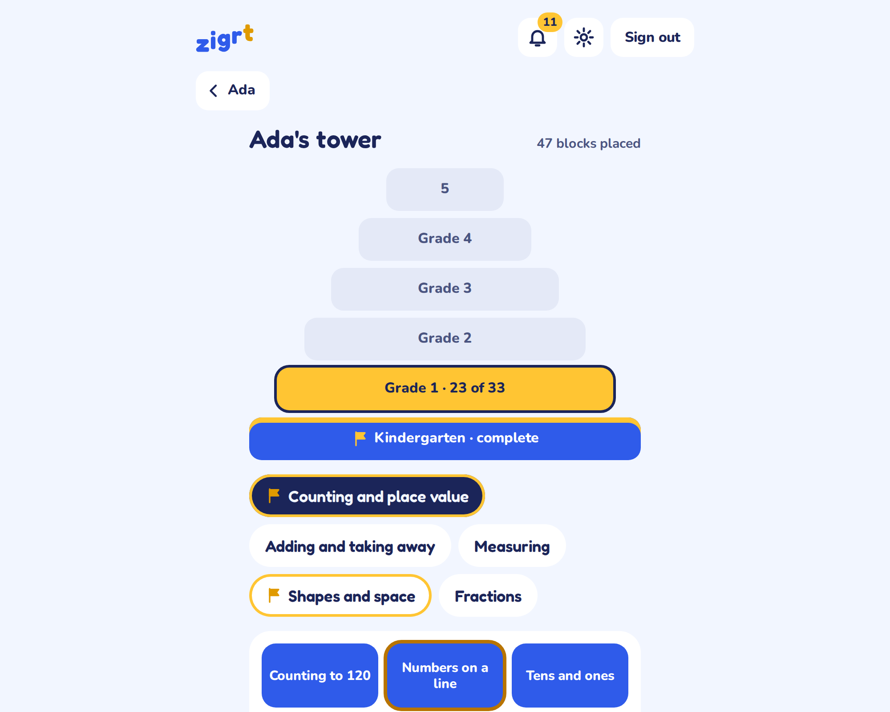
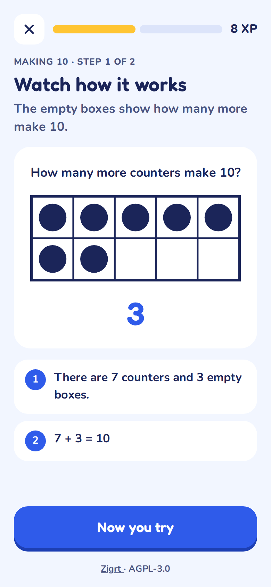
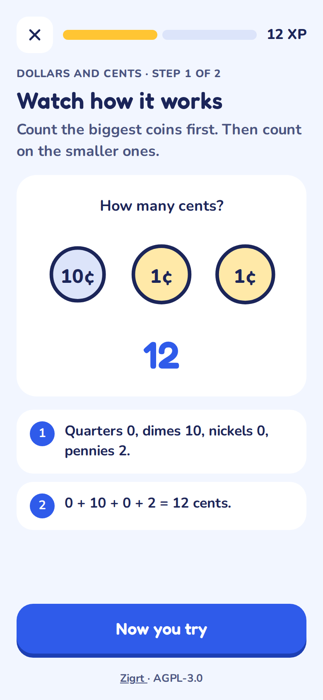
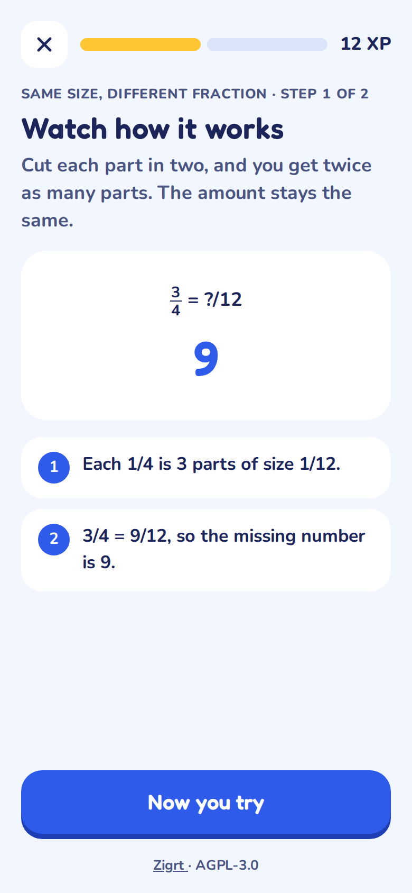

# How Zigrt teaches

Zigrt is mastery learning: a child learns a block only once the blocks under it are solid, and keeps what they learned by reviewing it just before it would be forgotten. The full rules, with every number, are in the [plan](../design/plan.md#3-learning-model); this page is the short version.

## The tower

The K-5 curriculum is 255 **blocks** (topics), from counting to 10 up to dividing by unit fractions. Each block lists the blocks it **requires**: "add 2-digit numbers with regrouping" requires "add 2-digit and 1-digit numbers". Laid out by grade, they make the tower a student climbs, one tier per grade.

A block is **placed** once it is mastered. The next lesson is always a block whose requirements are all placed, so a child is never taught something they lack the footing for.

## A lesson

A lesson has one to three **steps**. Each step shows a worked example ("Watch how it works"), then asks problems until the child gets two right in a row. Three misses in one step pause the lesson with a kind message; it comes back later.

If a lesson is paused twice, Zigrt reviews the blocks it is built on first, then offers the lesson again. Parents get a notification, in case the child needs a hand.

Problems are generated from templates, so a child who retries sees new numbers, not the same question. Pictures (ten frames, coins, number lines, area models, protractors and more) are drawn by the server as part of the problem.

  

## Reviews

A placed block comes back as a five-problem **review** (four right passes), after 1, 3, 7, 14, 30, 60, 120 and then 240 days. Each pass pushes the next one further out. A failed review brings it back sooner; two in a row reopen the lesson.

Reviews don't pile up as busywork:

- **Credit from harder work.** Practising a block also exercises the blocks inside it. Long multiplication exercises the times tables, so their reviews move out without being asked.
- **Compression.** When several reviews are due, one review of a harder block can stand in for the easier blocks it contains.
- **Catching up.** After a break, while more than ten reviews are due, a student does five reviews before each new lesson instead of three, so the backlog clears without new learning stopping.

## Placement and quizzes

The **placement check** asks up to 35 questions, choosing each one to learn the most. A right answer is evidence for that block and everything under it; "I haven't learned this" rules out that block and everything above it. Blocks with enough evidence are placed. Parents who already know where a child is can [start them at a grade](parents.md#choosing-where-a-child-starts) instead.

A **quiz** comes after about every 150 XP: eight to ten problems from recently learned blocks. A missed block's review comes due at once.

## Pace and honesty

- XP is roughly a minute of focused work. Lessons earn the block's XP, with a bonus for a clean run; reviews earn 4 to 5.
- Answers that come too fast three times running pause the task with a "slow down" screen and earn nothing.
- Fact blocks (like times tables) can have a speed target: their reviews pass only when answers are quick. The child never sees a timer, and a parent can turn it off.
- There is no AI at run time. Every explanation and problem is written in the content pack and checked before release ([ADR 5](../adr/0005-no-llm.md)).
