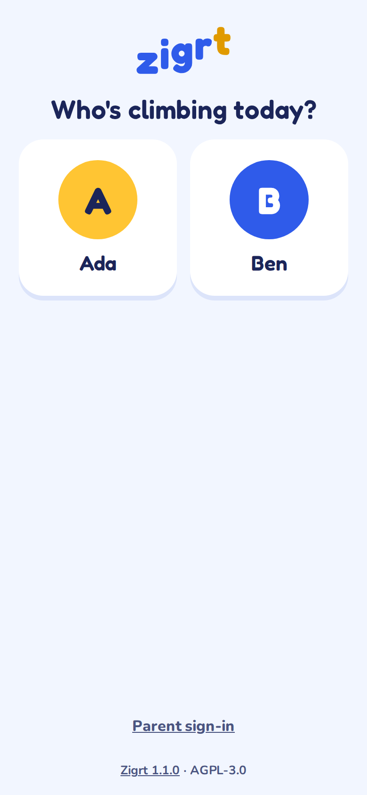
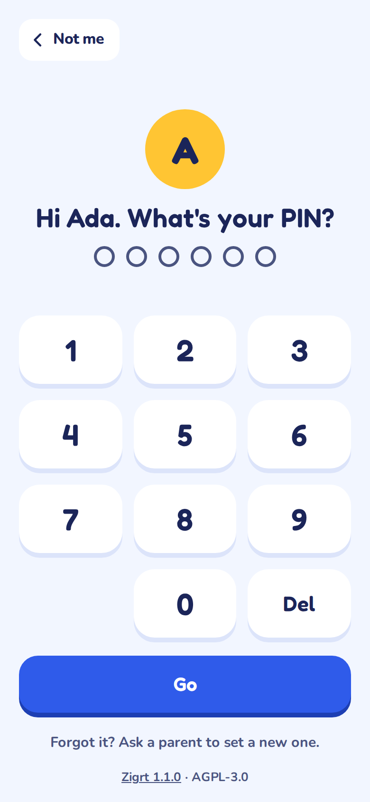
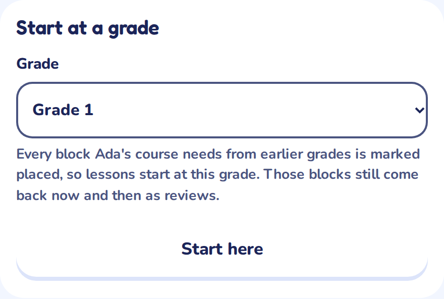
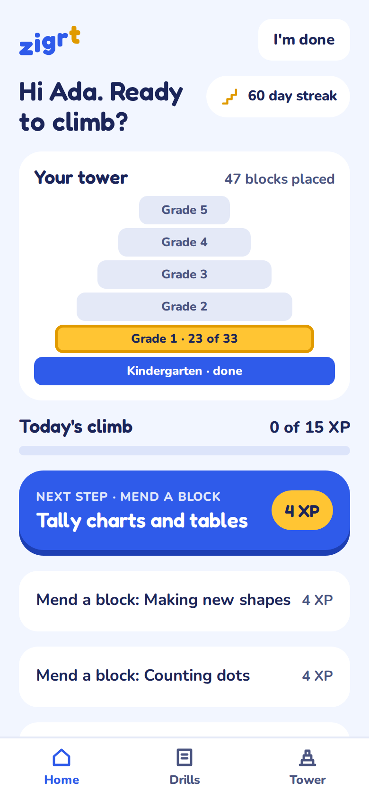
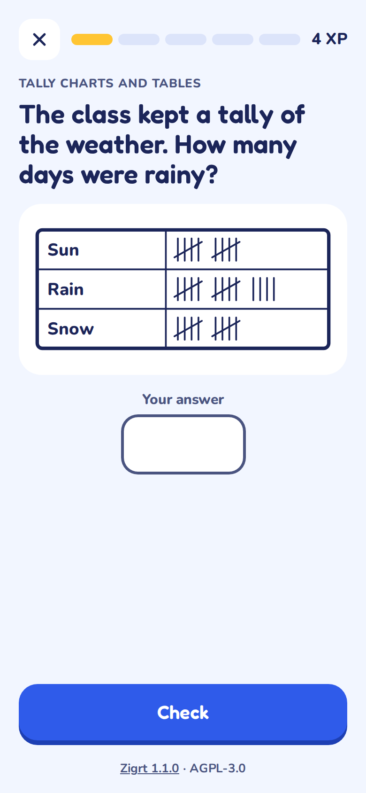
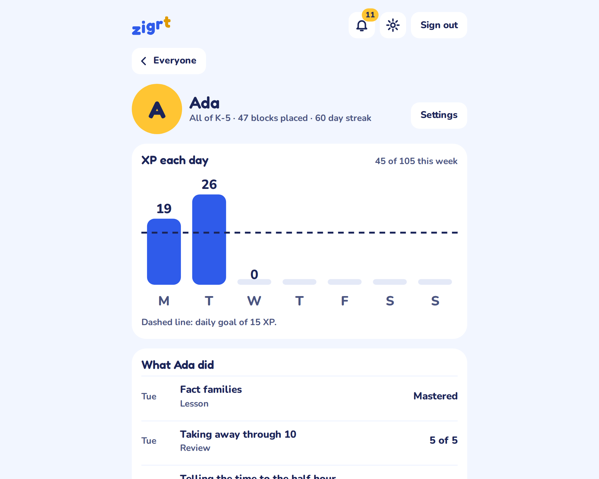

# Using Zigrt

A guide for parents: setting up, choosing where each child starts, and what to look at from week to week. How the learning itself works is in [How Zigrt teaches](how-it-works.md).

## First run

1. Take the one-time setup token from the server log (see [Install](../operations/install.md)) and open `/setup`.
2. Create the first parent: your name, email and a password. The household's time zone is set here too; days, streaks and rest days follow it.
3. Add a student: a name, a colour and a 4 to 6 digit PIN.

More parents can be added from **Household → Parents**. Every parent sees every student.

## Signing in

- **Students** pick their name on the home screen and type their PIN on a big number pad. Ten wrong PINs in a row lock them out until a parent unlocks them (you get a notification).
- **Parents** sign in from the quiet **Parent sign-in** link with their email and password.
- Sessions stay signed in on a device. A student ends theirs with **I'm done**.

 

## Choosing where a child starts

Each student has a **course** (Settings → Learning): all of K-5, or a single grade. A course covers its grade and every earlier block that grade builds on, so a Grade 2 course still includes the Kindergarten and Grade 1 blocks that Grade 2 needs.

There are three ways to skip what a child already knows:

| Way | Where | Best when |
| --- | --- | --- |
| **Placement check** | Offered to a new student on their first sign-in; run it again from Settings | You aren't sure what they know. Up to 35 questions find it out |
| **Start at a grade** | Settings → Start at a grade | You know they've finished the earlier grades. Every earlier block in their course is marked placed in one go |
| **Mark a block** | Settings → Mark a block as placed or not | Fixing one block either way |

They combine well: start a child at their grade, then run the placement check to find where they are within it. The check skips blocks that are already placed.

While the placement check is waiting, a student can choose **Start from the bottom instead** on their home.

Blocks marked placed still come back now and then as short reviews, so a gap shows up as a missed review and is mended, not a silent hole.

## A student's day

The student's home shows today's climb against the daily goal, their tower, and up to four tasks. The big button is the recommended one.

- **Lessons** teach one block in small steps: a worked example, then problems until it sticks.
- **Reviews** ("Mend a block") bring back something learned earlier, just before it would be forgotten.
- **Quizzes** come after every 150 XP or so and mix recent blocks.
- **Drills and worksheets** are free practice. They never change what is placed.

 

XP is about a minute of focused work. The daily goal is 15 XP to start; change it in Settings. A **streak** counts days the goal was met; **rest days** never break one.

## Settings for each student

Parent → a student → **Settings**:

- **Profile:** name and colour.
- **Learning:** course, daily goal, rest days, and **count speed on number facts**. With it on, fact reviews (like times tables) pass only when answers come quickly; the child never sees a timer.
- **Start at a grade**, **Run the placement check again**, **Mark a block as placed or not**.
- **Assign a drill or worksheet:** it shows on the student's home until done.
- **PIN:** set a new one. This signs the student out everywhere.
- **Delete** the student and all their history (you type their name to confirm). This is the one thing that can't be undone.

## Keeping an eye on progress

- The **dashboard** has a card per student: this week's XP against the goal, the streak, and new blocks placed.
- A **student's page** shows XP each day, what they did, and their tower by grade and strand.
- The **bell** collects notifications: a student locked out, a lesson stopped twice (they may need a hand), a streak lost, a grade or strand finished, new lessons installed. "Goal met" notifications are off unless you turn them on in **Household → Notifications**.
- With email set up, a **weekly summary** goes out on Sunday evening. See [Email](../operations/email.md).

## Worksheets for the fridge

**Make a worksheet** (dashboard) builds a printable sheet: operations, levels, layout and count, with name and date lines, large print and an answer key on its own page. Every sheet keeps its problems, so it reprints the same; **New version, same settings** gives fresh ones.

## The household

**Household** holds parents and passwords, notifications, the weekly email, the time zone, the lessons installed, **Back up now** and **Export everything**, and API tokens. See [Backups](../operations/backup.md) and [API and MCP](../operations/api.md).
